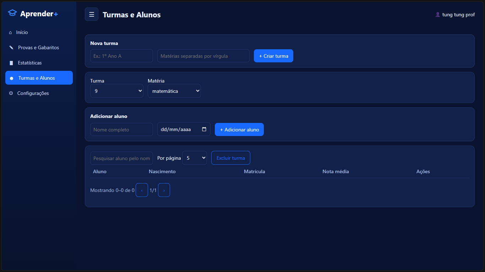
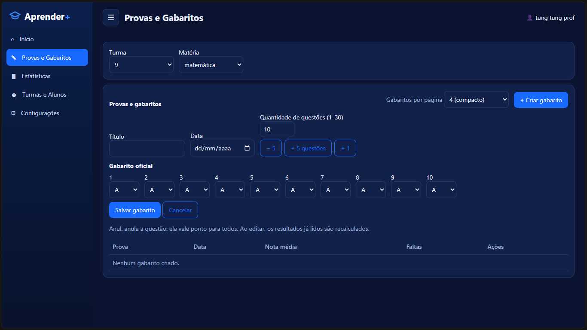
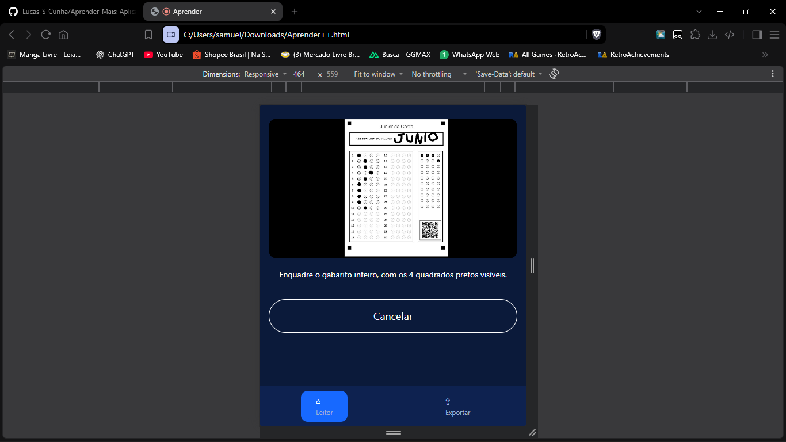
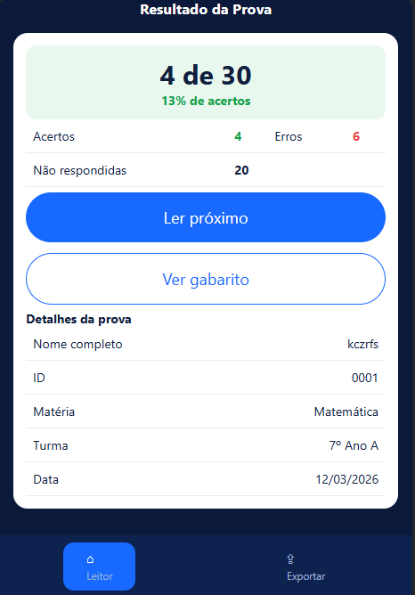
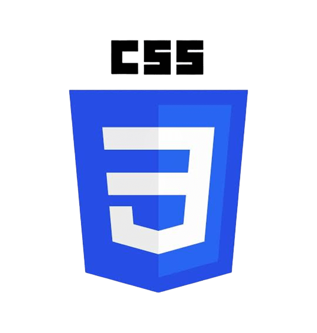
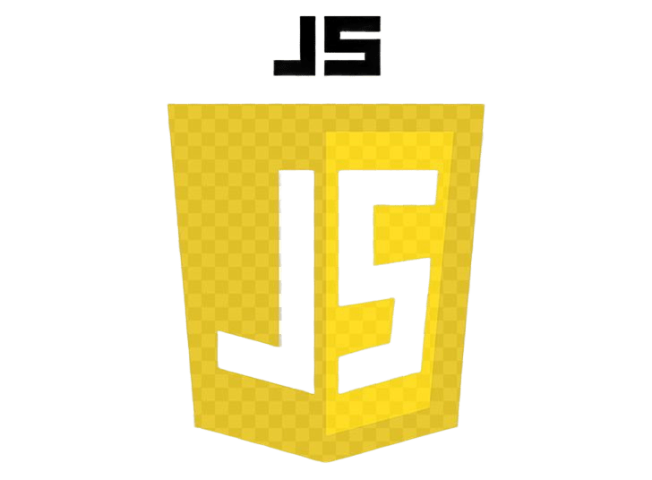

# 🎓 Aprender+

> **Sistema de gerenciamento de provas, alunos, turmas e leitura de gabaritos.**

## 📖 Sobre o projeto

O **Aprender+** é uma plataforma desenvolvida para auxiliar na organização de avaliações escolares. O sistema reúne recursos para cadastrar turmas e alunos, criar provas e gabaritos e realizar a leitura das respostas dos estudantes.

A proposta é tornar a preparação, a aplicação e o acompanhamento das avaliações mais simples e organizados.

## 🖥️ Visão geral

O Aprender+ foi pensado para uso em diferentes tamanhos de tela.

## ✨ Funcionalidades

### 👨‍🎓 Alunos e turmas
- Criação e gerenciamento de turmas.
- Cadastro de alunos vinculados às respectivas turmas.
- Registro do nome e da data de nascimento dos alunos.
- Organização das turmas e matérias.

### 📝 Provas e gabaritos
- Criação e gerenciamento de provas.
- Definição do título e da quantidade de questões.
- Configuração das alternativas disponíveis.
- Organização dos gabaritos relacionados às avaliações.

### 📷 Leitor de gabaritos
- Leitura dos gabaritos dos alunos.
- Identificação das respostas marcadas.
- Comparação das respostas com o gabarito correto.

Exemplo da tela de resultado da leitura:

### 📊 Estatísticas
- Visualização de informações e indicadores relacionados às avaliações.
- Acompanhamento dos resultados apresentados pelo sistema.

.png)

## 🏠 Tela inicial

A página inicial reúne o acesso às principais áreas do sistema, como alunos e turmas, provas e gabaritos, estatísticas e configurações.

.png)

## 💻 Tecnologias utilizadas

As tecnologias utilizadas no desenvolvimento da interface e das funcionalidades são:

  
  
  

- **HTML5** — estrutura das páginas.
- **CSS3** — estilização e apresentação visual.
- **JavaScript** — funcionalidades e interações do sistema.

## 🚀 Como utilizar

1. Acesse a plataforma e realize seu cadastro.
2. Entre no sistema para visualizar a página inicial e o menu de navegação.
3. Na seção **Alunos e Turmas**, crie uma turma informando seu nome e as matérias.
4. Selecione a turma e cadastre os alunos, preenchendo o nome e a data de nascimento.
5. Na seção **Provas e Gabaritos**, escolha a opção de criar prova e informe o título, a quantidade de questões e as alternativas.
6. Utilize os recursos de gabarito e o leitor para registrar e conferir as respostas dos alunos.
7. Consulte a seção **Estatísticas** para acompanhar os resultados disponibilizados.

## 👥 Equipe de desenvolvimento

- **Desenvolvedor(a):** Adicione seu nome aqui.
- **Colaboradores:** Adicione os nomes dos participantes do projeto.

## 📌 Status do projeto

🚧 **Em desenvolvimento.**

## 📄 Licença

Projeto desenvolvido com finalidade educacional. Caso seja adotada uma licença de distribuição, informe-a nesta seção.
